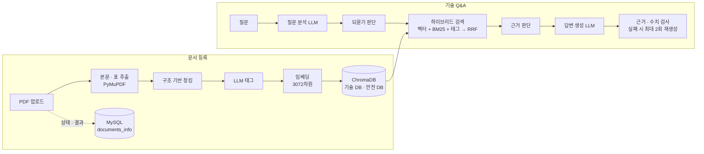

# MANSA — Manual & Safety Assistant

**승강기 기술 사양서와 안전기준을 질문 하나로 함께 찾고, 출처와 함께 답하는 RAG 서비스**

> 현대 AI 인사이트 캠퍼스 1차 프로젝트 · 6팀 무베기 (6명) · 2026.10.20 ~ 10.30 (발표 11.02)
> 이 저장소는 팀 저장소 [HYUNDAI-AI-team6/mansa](https://github.com/HYUNDAI-AI-team6/mansa)를 fork한 포트폴리오용 저장소입니다.

| 항목 | 내용 |
| --- | --- |
| 내 역할 | **문서 처리 담당**: PDF 추출 · 구조 기반 청킹 · LLM 태그 · 임베딩 검증 · 문서 서비스(DocumentService) |
| 기여 규모 | PR 12개 · 커밋 53개 · 내가 작성한 테스트 328개 (13개 파일, 전부 통과) |
| 주요 기술 | Python 3.11 · PyMuPDF · OpenAI API(LLM · `text-embedding-3-large`) · LangChain · ChromaDB · MySQL · Gradio |

---

## 1. 프로젝트 소개

### 해결하려는 문제

승강기 유지관리 기술자는 점검 전에 두 종류의 문서를 오가야 합니다.

- **흩어진 문서**: 작업 절차와 사양은 제조사 사양서에, 지켜야 할 조건은 안전기준에 있습니다.
- **다른 수치**: 사양서의 값과 안전기준의 값이 다르면 사람이 직접 비교해야 합니다.
- **근거 재확인**: 답을 찾아도 출처 문서와 쪽수를 다시 열어 봐야 믿고 작업할 수 있습니다.

국내 승강기는 88.6만 대(2025년 말)이고 기술자 한 명이 90~100대를 맡습니다. 짧은 점검 시간 안에 사양과 안전기준을 정확히 대조하는 도구가 필요하다고 보고 MANSA를 만들었습니다.

### MANSA가 하는 일

- 기술 문서 DB와 안전 문서 DB를 **함께 검색**하고, 답을 `작업 절차 · 사양 수치 · 안전 요건 · 기준 차이` 4영역으로 나눠 보여 줍니다.
- 사양서와 안전기준의 수치는 LLM이 아니라 **코드가 단위를 맞춰 비교**합니다.
- 답변의 숫자는 근거 원문과 대조하고, 근거가 없으면 지어내지 않고 **"찾을 수 없습니다"**로 안내합니다.
- 모델이나 부위가 빠진 질문은 **되묻기**로 범위를 좁힙니다. 안전 요건에는 "최종 판단은 안전관리자 확인" 문구를 항상 표시합니다.

### 주요 기능

| 사용자 (현장 기술자) | 관리자 (안전 · 서비스 관리자) |
| --- | --- |
| 기술 Q&A: 4영역 답변, 근거 원문 탭, 되묻기, 이어서 질문 | 문서 관리: 처리 상태(처리 중 · 완료 · 실패), 청크 수, 실패 사유, 삭제 |
| 질문 기록: 지난 대화 다시 열기 | 문서 업로드: PDF · 문서 유형 · 부서 지정 |
| 문서 조회: 유형 · 부서 · 이름으로 찾기 | 기준정보: 부서, 설비 모델, 작업 분류표 · 관계표, 동의어 |
| 고객센터: 사용법 안내 챗봇 | 평가 · 질문 테스트 · 회원 관리 |


> 화면 설계 단계의 캡처라서 `[모델 A]`, `[값]` 같은 예시 데이터가 들어 있습니다.

---

## 2. 시스템 구조



- 문서 등록: 화면은 문서 행을 즉시 등록하고, 추출부터 저장까지는 백그라운드 스레드에서 처리합니다. 결과(청크 수, 실패 사유)는 MySQL에 기록합니다.
- 기술 Q&A: 매뉴얼 DB와 안전 DB를 각각 검색한 뒤, 한쪽 문서로 쏠리지 않게 근거를 번갈아 합칩니다.

위 그림의 문서 등록 흐름 중 **본문 · 표 추출 → 청킹 → LLM 태그 → 임베딩 검증 → `documents_info` 기록**이 제가 맡은 부분입니다.

---

## 3. 내가 맡은 일

### ① PDF 본문 · 표 추출 — [PR #69](https://github.com/HYUNDAI-AI-team6/mansa/pull/69)

`mansa/features/processing/pdf_text.py` · `pdf_tables.py` · `pdf_content.py`

- PyMuPDF로 페이지별 본문과 표를 **따로** 읽고, 표 영역의 글자가 본문에 중복으로 들어가지 않게 처리했습니다.
- **스캔 PDF 판별**: 글자가 50자 미만인 페이지를 "글자 없음"으로 보고, 글자 있는 페이지가 30% 미만이면 거절합니다. OCR은 범위 밖으로 결정하고 문서에 남겼습니다.
- **표 신뢰도**: 빈 셀이 50%를 넘거나 2×2 이하인 표는 구조가 틀렸을 수 있다고 표시하고 청크로 쓰지 않습니다.
- **숫자 복원**: 셀 안에서 글자와 섞여 깨진 소수점 · 쉼표를 복원합니다(예: 사양표의 하중 · 치수).

### ② 구조 기반 청킹 — [PR #117](https://github.com/HYUNDAI-AI-team6/mansa/pull/117)

`mansa/features/processing/chunker_secure.py` · `chunker_tech.py` · `chunk_utils.py`

| 문서 | 나누는 기준 |
| --- | --- |
| 안전기준 | **조항 번호**(예: 6.5.1.2) 단위. 본문 속 숫자를 조항으로 오인하지 않도록 "직전 조항의 다음 번호인가"를 검증합니다. 긴 조항은 나누면서 `[8.2.1.2 일반사항 계속]` 같은 머리말을 붙입니다 |
| 기술사양서 | **페이지 + 제품 모델 + 표 행** 단위. 모델 이름은 기준정보에 등록된 이름으로만 찾고(긴 이름 우선, 단어 경계 확인), 한 페이지에 모델이 여럿이면 모델마다 청크를 만듭니다 |

- 공통 규칙: 페이지를 넘지 않음(출처가 파일 · 페이지로 표시되기 때문), 300~1,200자, 표 행은 `열 이름: 값` 문장으로 변환
- 청크 ID는 `{문서id}:p{페이지}:{순번}`이라 답변의 근거 ID로 그대로 쓰입니다.
- **결과**: 안전기준 349개, 엘트론 기술사양서 27개, LUXEN 카탈로그 81개 청크

### ③ LLM 태그 생성 — [PR #132](https://github.com/HYUNDAI-AI-team6/mansa/pull/132)

`mansa/features/processing/tagger.py`

- 청크마다 부위 · 작업 태그를 붙여 검색 순위 신호로 씁니다. LLM은 **분류표의 공식 이름 안에서만** 고르고, 분류표에 없거나 본문에 근거 단어가 없는 태그는 코드가 버립니다.
- 분류표 부위가 본문에 하나도 없는 청크는 LLM을 부르지 않아 호출 수를 줄였습니다.
- 배치 하나가 실패해도 문서 처리를 멈추지 않고 그 청크만 태그 없이 저장합니다.
- 실제 PDF 기준으로 분류표를 **부위 5→37개, 작업 5→49개**로 확장했습니다.

### ④ 문서 서비스와 처리 결과 기록 — [PR #138](https://github.com/HYUNDAI-AI-team6/mansa/pull/138) · [PR #153](https://github.com/HYUNDAI-AI-team6/mansa/pull/153)

`mansa/features/documents/` · `mansa/migrations/`

- `DocumentService`: 문서 등록(같은 파일 이름 · 유형 중복 거절), 조회, 목록, 상태 변경(처리 중 · 완료 · 실패), 삭제
- 원본 PDF 저장소와 `documents_info` 테이블 마이그레이션(0001 현재 구조, 0002 컬럼 추가)
- 처리 결과 기록: 완료 시 `chunk_count`, 실패 시 `error_message`. 실패 사유에서는 API 키와 스택 트레이스를 지우고 1,000자 안으로 줄입니다.
- 기존 마이그레이션은 고치지 않고 새 파일을 추가해 변경 이력을 남겼습니다.

### ⑤ 임베딩 입력 · 결과 검증 — [PR #140](https://github.com/HYUNDAI-AI-team6/mansa/pull/140)

`mansa/core/llm.py` (`embed`)

- 빈 문자열 입력을 거절하고, 결과 벡터가 입력 개수와 같은지, 3,072차원인지 확인한 뒤 저장합니다. 차원이 다른 벡터가 섞여 검색이 깨지는 문제를 저장 전에 막습니다.

### ⑥ 협업 기반

- 이슈 · PR 템플릿([#1](https://github.com/HYUNDAI-AI-team6/mansa/pull/1) · [#2](https://github.com/HYUNDAI-AI-team6/mansa/pull/2)), 프로젝트 초기 구조와 UTF-8 설정([#6](https://github.com/HYUNDAI-AI-team6/mansa/pull/6) · [#10](https://github.com/HYUNDAI-AI-team6/mansa/pull/10) · [#21](https://github.com/HYUNDAI-AI-team6/mansa/pull/21)), CodeRabbit 자동 리뷰 연결([#26](https://github.com/HYUNDAI-AI-team6/mansa/pull/26))
- 팀 최종 WBS와 기능 · 메소드 명세서를 실제 PR · 코드 기준으로 정리했습니다.

### 검증

- 단위 테스트 328개(추출 · 청킹 · 태그 · 문서 서비스 · 임베딩), 외부 서비스 없이 실행됩니다.
- 실제 환경 확인: 실제 PDF 3개 추출 · 청킹, 실제 LLM으로 태그 생성, 실제 MySQL에서 등록 · 중복 거절 · 상태 변경 · 삭제, 실제 임베딩으로 ChromaDB에 저장 → 개수 확인 → 삭제(엘트론 27개 · 안전기준 349개, 끝난 뒤 남은 청크 0개)

---

## 4. 문제 해결 기록

| 문제 | 원인 | 해결 | 결과 |
| --- | --- | --- | --- |
| 조항 · 표 행이 청크 중간에서 잘림 | 초기 방식은 800자 단위 분할(겹침 100자) | 조항 번호 · 페이지 · 모델 · 표 행 같은 **의미 경계**로 분할 | 근거 1개가 조항 1개 · 표 행 1개와 대응 |
| 본문 속 숫자를 조항 번호로 오인 | 본문의 수치가 조항 번호(예: 6.5.1)와 같은 형식으로 쓰인 경우가 있음 | "직전 조항의 다음 번호인가"를 검증한 뒤에만 조항으로 인정 | 조항 경계 오판 방지 |
| PDF에서 모델명을 잘못 뽑음 | 규칙으로 제품명을 추측하면 "PASSENGER ELEVATORS" 같은 일반 문구가 섞임 | 기준정보에 등록된 모델 이름만 찾고, 긴 이름 우선 · 단어 경계 확인 | 질문 분석과 같은 이름을 써서 모델 필터 연결 준비 완료 |
| 표 숫자가 깨짐 | 셀 안의 글자와 숫자가 섞여 소수점 · 쉼표가 분리됨 | 셀 단위 숫자 복원 규칙 추가 | 사양표 수치를 원문대로 보존 |
| LLM 태그가 많이 빠짐 | 한 번에 15개 청크를 보내니 응답에서 일부가 누락됨 | 배치를 5개로 줄이고, 배치 실패를 청크 단위로 격리 | 태그가 붙은 청크 **88개 → 150개** (안전기준) |
| 태그를 필터로 쓰면 검색 누락 | 태그는 일부 청크(안전기준 43%)에만 붙음 | 질의응답팀에 태그를 **필터가 아닌 순위 신호**로 쓰도록 제안해 반영 | 태그 없는 청크도 검색 후보에 남음 |
| 업로드 결과를 알 수 없음 | 처리 결과가 로그에만 남음 | `chunk_count` · `error_message` 컬럼을 새 마이그레이션으로 추가하고 기록 | 관리자 화면에서 청크 수와 실패 사유 확인 |

---

## 5. 팀 성과와 평가 분석

- 기획 기능 5개 중 4개 구현(본문 · 표 분리 추출, 하이브리드 검색, 근거 중심 답변, 기술 + 안전 교차 답변). 모델별 필터는 청크 · 질문 분석에 모델 정보까지 저장하고, 검색 연결은 다음 단계로 남겼습니다.
- 팀 PR 84개(GitHub 전체), 테스트 파일 43개
- **평가 50문항 1차 실행(10/31)**: 검색 적중률 40.0% · 수치 정확도 31.2% · 출처 정확도 40.0% · 표현 일관성 32.0% · 과잉 첨부율 30.4%, 평균 응답 11.6초

**평가 결과 원인 진단 (직접 수행)**

점수가 낮은 이유를 확인하려고, 50문항을 답변 생성 전 단계(질문 분석 → 되묻기 판단 → 검색)까지만 다시 돌려 어디서 멈추는지 기록했습니다.

- 14문항이 **검색 전에** 멈췄습니다. 모델이 있는데도 부위를 되묻거나(8문항), 범위 밖 질문으로 잘못 판정(6문항)한 경우입니다. 평가 세트는 되묻기를 오답으로 칩니다.
- 근거 판단 기준값(0.3)을 의심했지만, 검색까지 간 문항의 최고 점수는 가장 낮은 것도 0.46이라 **기준값은 원인이 아니었습니다.**
- 검색 설정(후보 수, 근거 개수)을 6가지로 바꿔 봐도 정답 근거 적중은 30/36 → 최대 31/36이었습니다. 설정값보다 **되묻기 규칙과 질문 분석 프롬프트**를 고쳐야 한다는 결론을 얻었습니다.

---

## 6. 회고

- **잘한 점**: 함수 입력 · 출력을 명세서로 먼저 합의해서 6명이 동시에 개발했습니다. 청킹은 "글자 수"가 아니라 "출처로 보여 줄 단위"를 기준으로 설계해 검색 근거와 답변 출처가 자연스럽게 맞아떨어졌습니다.
- **배운 점**: LLM 출력(태그, 숫자)은 그대로 믿지 않고 코드로 한 번 더 검증해야 품질이 안정됩니다. 성능 문제는 추측보다 단계별로 측정해야 원인을 찾을 수 있었습니다(기준값 가설이 틀렸던 경험).
- **아쉬운 점**: 컬렉션 이름 · 임베딩 모델 같은 팀 간 약속이 늦게 맞춰져 중간 수정이 생겼습니다. 오버랩을 쓰지 않은 판단은 설계상 근거만 있고 측정으로 확인하지는 못했습니다.
- **다음에 할 일**: 되묻기 · 범위 밖 판정 개선 후 재평가, BM25를 벡터 후보 안이 아니라 전체 문서 대상으로 확장, 모델별 검색 필터 연결, 스캔 PDF용 OCR

---

## 7. 실행 방법

```bash
git clone https://github.com/<내 GitHub 아이디>/mansa.git
cd mansa/mansa
uv sync --locked
cp .env.example .env    # OpenAI API 키, MySQL · ChromaDB 접속 정보를 직접 채움
uv run --locked python app.py
```

- 프로젝트 기간에 쓰던 Railway의 MySQL · ChromaDB는 팀 공용 서버라 이 저장소에서는 접속 정보를 제공하지 않습니다. 직접 실행하려면 자신의 서버와 API 키가 필요합니다.
- 테스트는 외부 서비스 없이 실행됩니다: `uv run --locked python -B -m unittest discover -s tests -v`

---

## 8. 팀 구성

| 이름 | 담당 |
| :---: | --- |
| 이세림 (팀장) | 질문 분석 · QAService 처리 순서 · 답변 불가 · 안전 문구 · 안전 문서 검색, LLM 호출 · 임베딩 |
| 강병훈 | 검색(BM25 · 태그 · RRF) · 답변 생성 · 되묻기 · 질문 기록 · 근거 원문, 기술 Q&A 화면 연결 |
| 박정환 | 화면 전체 틀, 기준정보, 문서 처리 파이프라인 · 삭제 · 업로드 흐름 · 화면 연결, 기준 차이 비교 |
| **장영균** | **문서 추출 · 청킹 · 태그 · 임베딩 검증, DocumentService(등록 · 조회 · 상태 · 결과 기록)** |
| 류영걸 | MySQL · ChromaDB 연결, 환경 변수, 로그인 · 세션 · 회원 관리, 문서 관리 화면(DB 연결) |
| 박규진 | 관리자 평가(백엔드 · 화면), 고객센터 챗봇, 사용자 문서 조회, 태그 필터 검색, 협업 규칙 |

원본 저장소: [HYUNDAI-AI-team6/mansa](https://github.com/HYUNDAI-AI-team6/mansa) · 기능 명세: [docs/FUNCTIONAL_SPEC.md](docs/FUNCTIONAL_SPEC.md)
